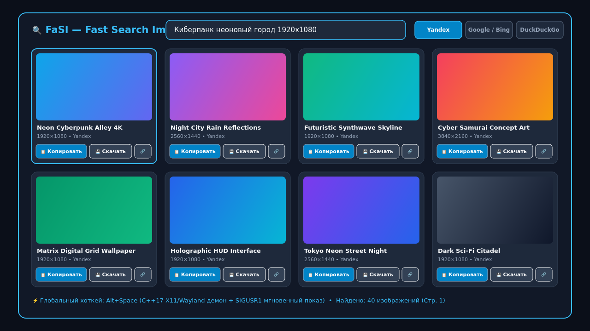

<div align="center">

🌐 **Language:** **English** | [Русский (README_Ru.md)](README_Ru.md)

# ⚡ FaSI — Fast Search Images

**Lightning-fast desktop overlay for searching, previewing, and copying images via `Alt+Space`, built with PyQt6 and a native C++17 core (`libfasi_core.so`)**

[](https://python.org)
[](https://isocpp.org)
[](https://riverbankcomputing.com/software/pyqt/)
[](https://github.com/Goblin-Inc/FaSI/releases)

<br/>



</div>

---

## 📖 Overview

**FaSI (Fast Search Images)** is a lightweight Spotlight / Rofi-style hybrid launcher and overlay for Linux (X11 / Wayland / KDE Plasma), crafted for instantly finding references, wallpapers, icons, and illustrations right on top of your active windows without opening a heavy web browser.

### ✨ Key Features
- **Instant Summon (`Alt+Space` / `SIGUSR1`)**: runs as a single-instance background daemon. Running the binary again or pressing your global hotkey sends a `SIGUSR1` signal to the running process and pops up the overlay in **< 10 ms**.
- **Hybrid Python + C++17 Core (`libfasi_core.so`)**:
  - Native `cpp_core/image_cache.cpp` module handles ultra-fast FNV-1a (64-bit) cache key hashing and low-level disk thumbnail pool management.
  - Multi-threaded `ImageLoader` (`QThreadPool`) asynchronously fetches thumbnails in parallel with zero UI freezes.
- **Multi-Provider Search with Auto-Fallback**:
  - Supports **Yandex Images**, **Google / Bing Images**, and **DuckDuckGo Images** with 1-click provider switching.
  - Smart natural-language query sanitizer (`clean_query`) that strips conversational filler words automatically.
- **Built-in Lightbox & Clipboard Integration**:
  - Clicking any card opens a full-resolution preview dialog with image metadata and dimensions.
  - Copy either the raw image (`QPixmap`) or the direct image `URL` to your system clipboard in a single click.

---

## ⌨️ Shortcuts & Controls

| Key / Action | Description |
|---|---|
| `Alt + Space` | Toggle the FaSI overlay on top of all windows |
| `Enter` | Execute search for the entered query |
| `Click on card` | Open full-size image lightbox (`ImagePreviewDialog`) |
| `Copy Image` | Copy the actual image bitmap to the system clipboard (`Ctrl+V` into Discord / Telegram / GIMP) |
| `Copy URL` | Copy the direct link to the original image |
| `Download` | Save the original image to disk |
| `Esc` | Close the preview dialog or hide the overlay into the background |

---

## 🏗️ Project Architecture

```
FaSI/
├── main.py                  # Single-Instance daemon (/tmp/fasi_app.pid), SIGUSR1 handler, system tray
├── ui/
│   ├── main_window.py       # Frameless main overlay with drop shadow, search bar, and 4-column grid
│   ├── widgets.py           # Custom ImagePreviewWidget cards and modal lightbox dialog
│   └── styles.py            # Deep Indigo / Glassmorphism dark stylesheet (QSS)
├── core/
│   ├── search_engine.py     # Multi-engine parser (Yandex, Google/Bing, DuckDuckGo) + query cleaner
│   ├── image_loader.py      # QRunnable thread pool + ctypes bindings to the native C++17 library
│   └── settings.py          # Provider configuration, timeouts, and result limits
├── cpp_core/
│   ├── image_cache.cpp      # C++17 module: 64-bit FNV-1a URL hashing and disk cache auditing
│   └── CMakeLists.txt       # Shared library build configuration (libfasi_core.so)
└── assets/
    └── fasi.svg             # Vector application icon for KDE / GNOME
```

---

## 📦 Installation & Usage

### Option 1: Prebuilt `.deb` Package (Recommended for Ubuntu / Debian / KDE Neon)
Head over to [**Releases**](https://github.com/Goblin-Inc/FaSI/releases), download `fasi_1.0.0_amd64.deb`, and install it:

```bash
sudo dpkg -i fasi_1.0.0_amd64.deb
sudo apt-get install -f
```
After installation, **FaSI** will appear in your KDE/GNOME application menu and can be triggered via the `fasi` command.

### Option 2: Portable Archive or Running from Source (Arch Linux / Universal)
```bash
git clone https://github.com/Goblin-Inc/FaSI.git
cd FaSI

# Compile the native C++17 module (optional — prebuilt libfasi_core.so is already included)
g++ -O3 -shared -fPIC cpp_core/image_cache.cpp -o cpp_core/libfasi_core.so

# Arch Linux (pacman):
sudo pacman -S python python-pyqt6 python-requests python-beautifulsoup4 gcc
python3 main.py

# Or via the universal installer (Arch / Ubuntu):
./install.sh
```

---

## 📋 Changelog

### `v1.0.0` — Initial Public Release *(Current)*
- **Added**: Native C++17 core `libfasi_core.so` bound via `ctypes` with automatic pure-Python fallback.
- **Added**: Instant window toggling via UNIX `SIGUSR1` signal and system tray integration.
- **Added**: Three-tier search engine (`Yandex`, `Google/Bing`, `DuckDuckGo`) with natural-language query filtering.
- **Added**: Official `.deb` installer, custom SVG icon, and Linux `.desktop` integration.

---

<div align="center">
Developed by <a href="https://github.com/Goblin-Inc">@Goblin-Inc</a> • <a href="README_Ru.md">Русская версия</a>
</div>

## 📄 License
MIT © [Goblin-Inc](https://github.com/Goblin-Inc)
